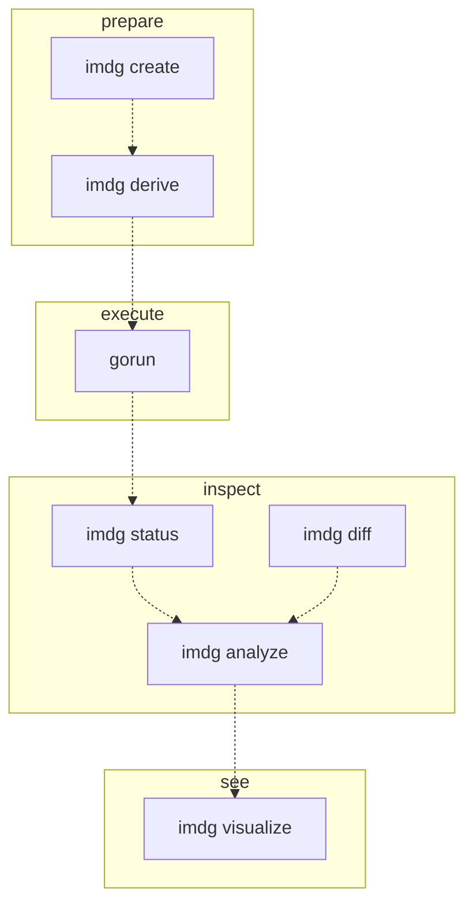

# IMDgroup-pymatgen

Python and command line tools for creating, modifying, running, and
understanding VASP calculations, built on top of
[pymatgen](https://pymatgen.org/).

Also, cluster-agnostic job-submission script (`gorun`) that runs VASP,
MACE fine-tuning, ATAT, and generic GPU jobs on Slurm clusters.

API documentation: https://yantar92.github.io/IMDgroup-pymatgen/



Each command is independent. The dashed arrows show one common path.

## Workflow manager compatibility

`imdg` operates on a plain VASP directory tree and it needs no
database or workflow-manager import. You can mix and match with
whatever already produces your calculations.

Because the tools read the directory itself, they also make it easy to
notice when two results are not comparable: `imdg analyze` groups runs by
identical settings, `imdg diff` shows where INCARs or structures differ,
and `imdg analyze` masks potentially problematic energies.

## High-throughput optimization

Parsing VASP outputs (XML, OUTCAR) is slow on supercomputer file
systems, so the tools cache parsed results on disk. The first
`imdg status` or `imdg analyze` over a tree pays the full parse cost;
later runs reuse the cache and only re-parse directories whose files
changed. This makes it practical to re-inspect a tree of hundreds or
thousands of calculations repeatedly while it is still evolving.

See the [Python API](https://yantar92.github.io/IMDgroup-pymatgen/python_api.html) for `IMDGVaspDir`, the class that
provides this.

## Installation

```bash
git clone https://github.com/yantar92/IMDgroup-pymatgen
cd IMDgroup-pymatgen
pip install .
```

This installs the `imdg` and `gorun` commands.

## Next steps

- [Quickstart](https://yantar92.github.io/IMDgroup-pymatgen/quickstart.html): example graphite (mp-48) workflow.
- [Why this exists](https://yantar92.github.io/IMDgroup-pymatgen/concepts.html): semi-automated workflow development.
- [Command-line reference](https://yantar92.github.io/IMDgroup-pymatgen/cli.html) and [job submission](https://yantar92.github.io/IMDgroup-pymatgen/gorun.html).
- [Python API](https://yantar92.github.io/IMDgroup-pymatgen/python_api.html).
