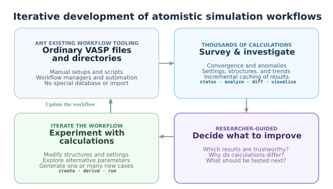

# -*- after-save-hook: (org-md-export-to-markdown); -*-
#+options: toc:nil
* IMDgroup-pymatgen
:PROPERTIES:
:ID:       d53f04c7-375d-4382-b314-a6ff99129c76
:END:

Python and command-line tools for *iterative development of
computational workflows* for VASP atomistic simulations, built on top
of [[https://pymatgen.org/][pymatgen]].

Works with ordinary calculation directories produced manually, by scripts,
or by *any existing workflow tooling that writes standard VASP files*.
The independent commands do not require a workflow manager or prescribe
how jobs must be executed.

Also includes ~gorun~, a cluster-agnostic job-submission script for VASP,
MACE fine-tuning, ATAT, and generic GPU jobs on Slurm clusters.

API documentation: https://yantar92.github.io/IMDgroup-pymatgen/

#+begin_src dot :exports results :file docs/img/workflow-development.svg :noweb no
  // IMPORTANT: do not indent the lines inside label=<...>.
  // Graphviz preserves leading spaces as text, causing apparent mis-centering.
  digraph IMDG_WorkflowDevelopment {
      graph [rankdir=TB, splines=ortho, bgcolor="transparent", pad=0.15, nodesep=0.43, ranksep=0.40, outputorder=edgesfirst, fontname="DejaVu Sans", labelloc=t, labeljust=c,
  	   label=<<TABLE BORDER="0" CELLBORDER="0" CELLSPACING="0" CELLPADDING="7"><TR><TD><B>Iterative development of atomistic simulation workflows</B></TD></TR></TABLE>>];
      node [shape=box, style="rounded,filled", fixedsize=true, width=3.95, height=1.92, penwidth=1.4, fontname="DejaVu Sans"];
      edge [color="#7F93AA", penwidth=1.8, arrowsize=0.72, arrowhead=vee];
      calculations [color="#B9CBDD", fillcolor="#F5F8FC", label=<
  <B>ANY EXISTING WORKFLOW TOOLING</B> 
  <B>Ordinary VASP files and directories</B>  
  Manual setups and scripts 
  Workflow managers and automation 
  No special database or import
  >];
      inspect [color="#92C7E7", fillcolor="#F0F9FF", label=<
  <B>THOUSANDS OF CALCULATIONS</B> 
  <B>Survey &amp; investigate</B>  
  Convergence and anomalies 
  Settings, structures, and trends 
  Incremental caching of results  
  <B>status · analyze · diff · visualize</B>
  >];
      researcher [color="#9A85D6", fillcolor="#F7F3FF", penwidth=1.8, label=<
  <B>RESEARCHER-GUIDED</B> 
  <B>Decide what to improve</B>  
  Which results are trustworthy? 
  Why do calculations differ? 
  What should be tested next?  
  >];
      refine [color="#9ECAA9", fillcolor="#F2FAF4", label=<
  <B>ITERATE THE WORKFLOW</B> 
  <B>Experiment with calculations</B>  
  Modify structures and settings 
  Explore alternative parameters 
  Generate one or many new cases  
  <B>create · derive · run</B> 
  >];
      { rank=same; calculations; inspect; }
      { rank=same; refine; researcher; }
      calculations -> refine [style=invis, weight=20];
      refine -> researcher [style=invis, weight=20];
      calculations:e -> inspect:w [constraint=false];
      inspect:s -> researcher:n;
      researcher:w -> refine:e [constraint=false];
      refine:n -> calculations:s [constraint=false, color="#65A17E", penwidth=2.0, xlabel=<<B>Update the workflow</B>>];
  }
#+end_src

#+RESULTS:

~imdg~ can handle large collections of calculations (including
running) and detect anomalies or incomparable results.  It
deliberately *does not automate fixing anomalies*, leaving it up to
the user to explore the problems and identify the solutions (with the
optional help of ~imdg~ tooling).

** Workflow manager compatibility

~imdg~ operates directly on standard VASP directory trees without a
workflow manager-specific database or import. It can complement manual
calculations, custom scripts, and existing workflow managers.

~imdg analyze~ groups runs by identical settings, ~imdg diff~ compares
INCAR settings and structures, and ~imdg analyze~ provides calculation
summaries.

** High-throughput optimization

~imdg~ can handle directory trees containing *thousands of
calculations*. Parsing VASP outputs (XML, OUTCAR) is costly on
supercomputer file systems, so the tools cache parsed results on disk
(with invalidation if the original data changes).

See the [[https://yantar92.github.io/IMDgroup-pymatgen/python_api.html][Python API]] for ~IMDGVaspDir~, the class providing cached
directory inspection.

** Installation

#+begin_src bash
git clone https://github.com/yantar92/IMDgroup-pymatgen
cd IMDgroup-pymatgen
pip install .
#+end_src

This installs the ~imdg~ and ~gorun~ commands.

** Next steps

- [[https://yantar92.github.io/IMDgroup-pymatgen/quickstart.html][Quickstart]]: example graphite (mp-48) workflow
- [[https://yantar92.github.io/IMDgroup-pymatgen/concepts.html][Why this exists]]: semi-automated workflow development
- [[https://yantar92.github.io/IMDgroup-pymatgen/cli.html][Command-line reference]] and [[https://yantar92.github.io/IMDgroup-pymatgen/gorun.html][job submission]]
- [[https://yantar92.github.io/IMDgroup-pymatgen/python_api.html][Python API]]
